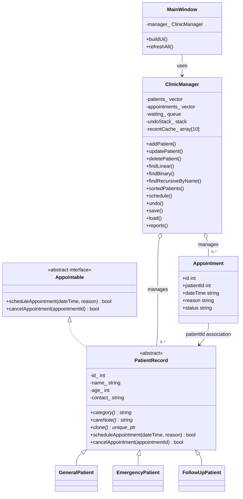

# SCAPMS UML Class Diagram

The Mermaid diagram below can be rendered by Mermaid-compatible Markdown viewers.

`PatientRecord` is abstract because it defines pure virtual category, care-note and clone functions. Its subclasses override these functions, demonstrating runtime polymorphism.
